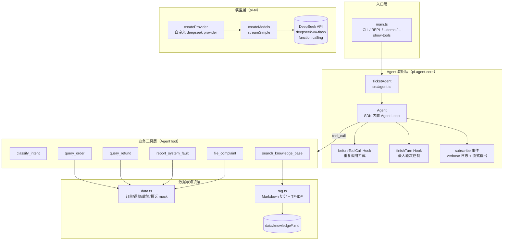
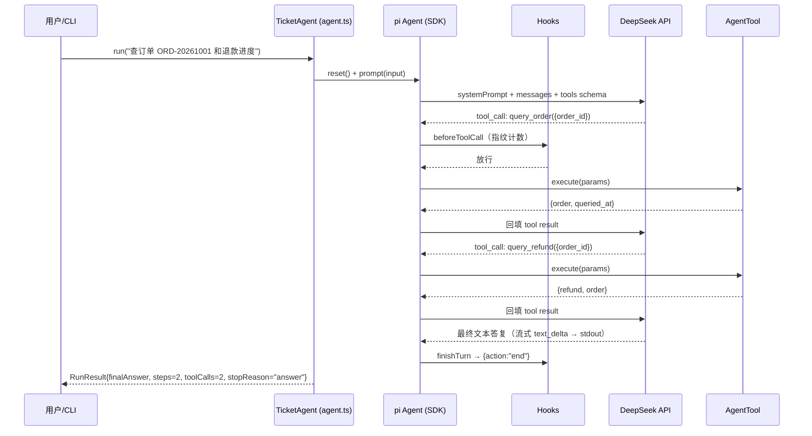

# ticket_agent_ts — 智能工单处理平台 Agent（pi SDK 版）

基于 **pi 框架 SDK**（[`@earendil-works/pi-agent-core`](https://www.npmjs.com/package/@earendil-works/pi-agent-core) + [`@earendil-works/pi-ai`](https://www.npmjs.com/package/@earendil-works/pi-ai)，v1.4.0）+ **DeepSeek** 实现的智能工单处理 Agent，TypeScript 全栈重写。

与本仓库的 `ticket_agent/`（Python 分层重实现版）互为对照：业务能力完全一致，但本项目不再手写 Agent Loop / 文本协议解析，而是把循环、工具调用、结果回填交给 pi SDK 的 `Agent` 与原生 function calling。

## 系统设计

用户以自然语言提出客服诉求，Agent 按需调用 6 个业务工具核实事实，最终给出中文答复：

| 场景 | 使用工具 |
| --- | --- |
| 诉求分类 | `classify_intent`（关键词规则分类器） |
| 订单/物流查询 | `query_order`（内存订单中心 mock） |
| 退款进度 | `query_refund`（按退款单号或订单号） |
| 产品咨询 | `search_knowledge_base`（Markdown + TF-IDF 检索，RAG） |
| 报错/故障反馈 | `report_system_fault`（采集诊断信息、分派团队、SLA） |
| 投诉登记 | `file_complaint`（优先级识别、关联订单） |

防护措施：

- **最大轮次**：`AGENT_MAX_STEPS`（默认 8），超限由 `finishTurn` Hook 终止；
- **重复调用拦截**：同一工具 + 同一参数指纹第 3 次出现时，`beforeToolCall` 返回 `{block: true, terminate: true}`；
- **错误兜底**：模型/API 错误、业务错误（如 `ORDER_NOT_FOUND`）均回填给模型或转为兜底文案，不会崩溃。

## 技术架构



## 功能模块划分

```
ticket_agent_ts/
├── src/
│   ├── config.ts          # 环境变量与 .env 加载（DEEPSEEK_API_KEY 等）
│   ├── model.ts           # 自定义 DeepSeek provider / createModels
│   ├── agent.ts           # TicketAgent：Agent 装配、Hook、事件、RunResult
│   ├── main.ts            # CLI / REPL / --demo / --show-tools
│   ├── data.ts            # 内存业务数据（订单、退款、故障、投诉）
│   ├── rag.ts             # Markdown 切分 + 汉字二元组 TF-IDF 检索
│   └── tools/             # 6 个 AgentTool（TypeBox schema + execute）
│       ├── intent.ts  order.ts  refund.ts
│       ├── knowledge.ts  fault.ts  complaint.ts
│       └── index.ts       # buildTools / describeTools
├── data/knowledge/        # 5 篇产品/售后知识库 Markdown
├── tests/
│   ├── helpers.ts         # faux provider 脚本化测试设施
│   ├── rag.test.ts        # 检索层（7）
│   ├── tools.test.ts      # 工具层（14）
│   ├── agent.test.ts      # Agent Loop 集成（10）
│   └── live.test.ts       # 真实 DeepSeek 联调（RUN_LIVE=1 才运行）
├── package.json  tsconfig.json
└── README.md
```

## 代码调用链路

一次问答的完整链路（以「查订单 + 退款进度」为例）：



关键调用点：

- `main.ts` → `buildTicketAgent()`：加载知识库 → `buildTools()` → `createDeepSeekModels()` → `new TicketAgent({model, streamFn: models.streamSimple.bind(models), tools, ...})`
- `agent.ts` → `new Agent({initialState: {systemPrompt, model, thinkingLevel: "off", tools}, streamFn, toolExecution: "sequential", beforeToolCall, finishTurn})`
- `thinkingLevel: "off"` 在 DeepSeek compat 下等价于发送 `thinking: {type: "disabled"}`（与 Python 版 `extra_body` 一致）。

## 与 Python 版的差异

| 维度 | Python 版（ticket_agent/） | 本版（ticket_agent_ts/） |
| --- | --- | --- |
| Agent Loop | 手写（agent_loop.py） | pi SDK `Agent` 内置 |
| 工具协议 | 文本 JSON 协议 + protocol.py 解析 | 原生 function calling |
| LLM 网关 | 手写 httpx 客户端（gateway.py） | pi-ai `createProvider` + `streamSimple` |
| 测试替身 | ScriptedGateway | pi `fauxProvider` + `setResponses` |
| 防护 | LoopGuard | `beforeToolCall` / `finishTurn` Hook |
| 业务逻辑 | tools/*.py | tools/*.ts（逐一移植，行为一致） |

## 运行

```bash
npm install          # 安装依赖（Node >= 20.12，推荐 24）

# 配置 API Key（任选其一）
setx DEEPSEEK_API_KEY sk-...        # 或在项目/仓库根目录 .env 中配置

npm start            # 交互模式（REPL；demo/help/exit 命令）
npm start -- "查询订单 ORD-20261001 的物流"   # 单轮问答
npm start -- --verbose "..."       # 打印 [agent_start]/[llm_request]/[tool_start] 等事件
npm run demo         # 跑 4 个内置业务场景
npm start -- --show-tools          # 查看模型可见的工具 schema（不调模型）

npm test             # vitest：31 passed + 1 skipped（live）
npm run typecheck    # tsc --noEmit
$env:RUN_LIVE="1"; npx vitest run tests/live.test.ts   # 真实 DeepSeek 联调
```

环境变量：

| 变量 | 默认 | 说明 |
| --- | --- | --- |
| `DEEPSEEK_API_KEY` | （必填） | DeepSeek API Key |
| `DEEPSEEK_BASE_URL` | `https://api.deepseek.com` | 兼容 OpenAI 协议的接入点 |
| `DEEPSEEK_MODEL` | `deepseek-v4-flash` | 模型 ID（自定义 provider 声明，可换成目录内任意模型） |
| `AGENT_MAX_STEPS` | `8` | 单次问答最大推理轮次 |
| `AGENT_VERBOSE` | 未设置 | 置非空即打印事件（等价 `--verbose`） |
